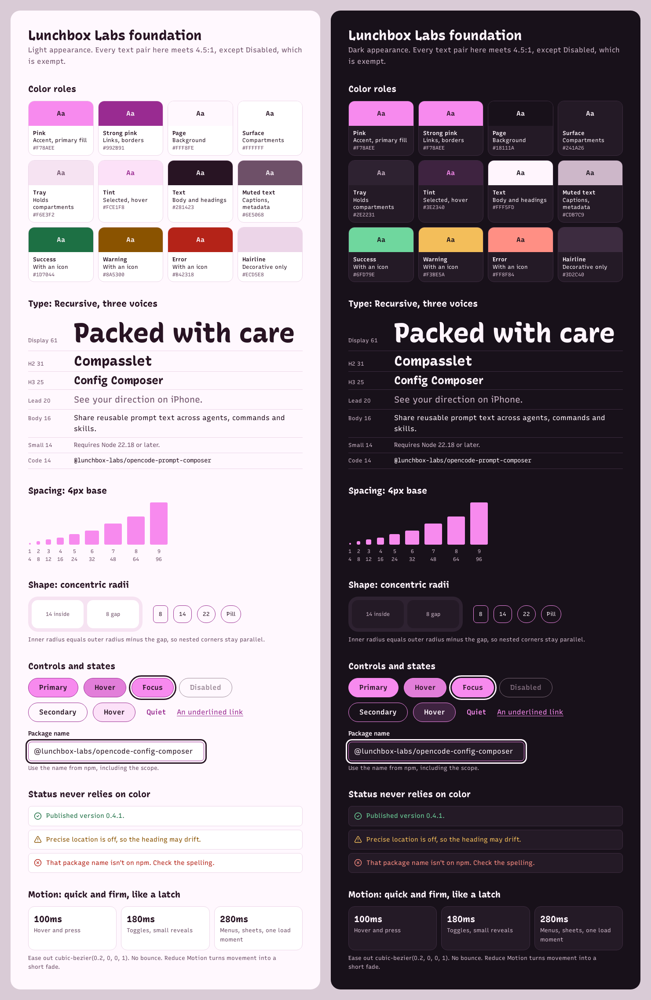

# Lunchbox Labs design foundation

This is the shared look for everything Lunchbox Labs ships, built on the [organization colors](colors.md). It sets the brand's tokens and principles. Each platform maps them onto its own idioms in a view guide: [web](web.md) and [iOS](ios.md). A repository keeps notes only where it differs.

## The idea

Small, careful software, packed with care. Three things carry it:

1. **The tray.** A page groups its main content in a tray of compartments: a tinted tray with surface-colored compartments inside it, separated by a narrow gap, with concentric corners. Use it once per screen, for the thing the screen is about. Everything else stays plain.
2. **Pink is the lid, not the lunch.** The brand pink marks the edge of the page, the one primary action and small accents. It never floods a background or a large area.
3. **A friendly voice in a precise hand.** Headings are set in a casual, hand-painted style; body text is crisp and plain; code is monospace. Together they read as warm and exact at once.

## Color

The base palette is in [organization colors](colors.md): pink, the pink label, the darker pink used for links and control borders (called strong pink here), page, surface, body text and focus, with their contrast checks. This foundation keeps those values and adds the roles below. All values are opaque sRGB.

| Role | Light | Dark | Use |
| --- | --- | --- | --- |
| Tray | `#F6E3F2` | `#2E2231` | The tray behind compartments, code blocks, quiet hover |
| Tint | `#FCE1F8` | `#3E2340` | Selected rows, secondary-button hover |
| Hairline | `#ECD5E8` | `#3D2C40` | Dividers and card edges that carry no meaning |
| Muted text | `#6E5068` | `#CDB7C9` | Captions, metadata, secondary text |
| Success | `#1D7044` | `#6FD79E` | Success messages, always with an icon or words |
| Warning | `#8A5300` | `#F3BE5A` | Warnings, always with an icon or words |
| Error | `#B42318` | `#FF8F84` | Errors, always with an icon or words |
| Disabled | `#9C8A98` | `#7D6A7A` | Disabled labels and borders |

Checked pairs for the new roles (WCAG relative luminance, rounded to two places; thresholds checked before rounding):

| Pair | Light | Dark |
| --- | --- | --- |
| Body text on tray / tint | 14.15 / 14.21 | 14.20 / 12.99 |
| Muted text on page / surface / tray / tint | 6.68 / 6.98 / 5.71 / 5.74 | 9.89 / 8.96 / 8.07 / 7.38 |
| Strong pink on tray / tint | 5.53 / 5.55 | 7.07 / 6.47 |
| Success on page / surface / tray | 5.82 / 6.08 / 4.98 | 10.49 / 9.51 / 8.56 |
| Warning on page / surface / tray | 6.06 / 6.33 / 5.18 | 10.87 / 9.85 / 8.87 |
| Error on page / surface / tray | 6.30 / 6.57 / 5.38 | 8.39 / 7.61 / 6.85 |

- Pink alone is 2.05:1 on the light page. Never use it for text, thin icons or a control's only edge in light appearance.
- Hairline is decorative (1.38:1 on the light surface, 1.31:1 on the dark one). A boundary that means something, like a field or a secondary button, uses strong pink.
- Disabled is exempt from contrast minimums but still pairs with a cue other than color, such as a missing hover.
- Status colors are never the only signal. Pair them with an icon and words. The pink is not a status color.

## Typography

One family, three voices. The web uses [Recursive](https://www.recursive.design) (SIL Open Font License), a variable font whose Casual and Mono axes give three voices from one file. Native apps use the platform's system family with the matching design.

| Voice | Use | Web (Recursive) | iOS |
| --- | --- | --- | --- |
| Display | Headings, hero, large numbers | Casual 1, weight 780, tracking -1.5% | SF Pro Rounded, bold |
| Body | Paragraphs, labels, controls | Casual 0, weight 400; 600 for emphasis | SF Pro |
| Code | Package names, commands, code | Mono 1, Casual 0 | SF Mono |

Scale, ratio 1.25 from a 16px or 17pt body:

| Step | Web | Role |
| --- | --- | --- |
| Display | 61px (39px on small screens) | One per page, the hero heading |
| H2 | 31px | Section headings |
| H3 | 25px | Compartment titles |
| Lead | 20px | The paragraph under a hero |
| Body | 16px | Everything else; never smaller for running text |
| Small | 14px | Captions, metadata, code in prose |
| Extra small | 13px | Legal lines and timestamps, sparingly |

- Line height 1.6 for body, 1.3 for small headings, 1.08 for display.
- Keep lines at 65 characters or fewer.
- Balance heading line breaks; never accent one word in a heading with color, italics or weight.
- No all-caps labels or eyebrows above headings, except where a platform draws them (iOS grouped section headers).

## Spacing

A 4-point base. Use these steps and nothing between them.

| Token | 1 | 2 | 3 | 4 | 5 | 6 | 7 | 8 | 9 |
| --- | --- | --- | --- | --- | --- | --- | --- | --- | --- |
| Value | 4 | 8 | 12 | 16 | 24 | 32 | 48 | 64 | 96 |

- Inside a control: 8 to 16. Between related items: 8 to 16. Inside a compartment: 24 to 32. Between sections: 64 to 96.
- Space grows with the size of what it separates. Related things sit closer than unrelated ones.

## Shape

Corners are concentric: an inner radius equals the outer radius minus the gap between them, so nested corners stay parallel.

| Token | Value | Use |
| --- | --- | --- |
| Small | 8 | Fields, chips, code blocks, toasts |
| Medium | 14 | Compartments and cards |
| Large | 22 | Trays (holding compartments with an 8 gap) |
| Pill | Full | Buttons |

Buttons are always pills. Apart from system controls such as switches, nothing else uses a pill shape, so a pill always reads as something to press.

A pressed or hovered pink fill darkens with a dark overlay, never by fading, so its label keeps its contrast: 10% on hover and 18% on press on the web, and 12% on press on iOS, which has no hover.

## Depth

Flat by default. Hierarchy comes from the page, tray and surface tones, not shadows.

- Only floating things (menus, popovers, toasts) get a shadow, tinted with the text color rather than grey: `0 1px 2px` at 8% and `0 12px 32px -8px` at 18% of `#281423`.
- Dark appearance raises with a lighter surface and a hairline instead of a shadow.
- No glassmorphism or gradient washes on the web. On iOS, use the system's materials where the system uses them.

## Motion

Quick and firm, like a latch closing. Motion answers what someone did; it doesn't decorate.

| Token | Duration | Use |
| --- | --- | --- |
| Fast | 100ms | Hover, press |
| Base | 180ms | Toggles, small reveals |
| Slow | 280ms | Menus, sheets, a page's one load moment |

- Easing: ease out `cubic-bezier(0.2, 0, 0, 1)` to enter, `cubic-bezier(0.3, 0, 1, 1)` to leave. No bounce or overshoot.
- At most one motion moment per page that nobody triggered.
- With Reduce Motion on, replace movement with a short fade (120ms or less) or nothing.

## Icons

- Web: [Lucide](https://lucide.dev), 1.75 stroke, 20px beside body text and 24px beside headings.
- iOS: SF Symbols, sized with the text they sit beside.
- Icons take the text color. Strong pink marks an active or brand icon. Never use emoji as icons.
- An icon-only control always has an accessible name.

## Voice

Plain, specific and friendly. Write like a careful person explaining their own work.

- Say what a thing does in one sentence, from the reader's side: "See your direction on iPhone", not "A powerful compass solution".
- No hype words (powerful, seamless, supercharge, effortless) and no exclamation marks in interface text.
- State requirements plainly: "Requires iOS 27 or later."
- Buttons say what happens: "Allow Location", "Visit the Compasslet site". The result reuses the same verb.
- Errors say what happened and how to fix it, without apology: "That package name isn't on npm. Check the spelling."
- Empty states invite the next step.
- Casing follows the platform: sentence case on the web; title case for iOS headings and control labels, sentence case for iOS explanations.

## Accessibility floors

These hold on every platform. The view guides add the platform's own rules.

- Text 4.5:1; large text (24px, or about 19px bold) and meaningful boundaries 3:1. On iOS, secondary text may use the system's semantic label colors, which adapt to Increase Contrast; essential text uses `label`.
- Targets at least 44 by 44.
- A visible focus outline, as [organization colors](colors.md) describes.
- Never rely on color alone for state or status.
- Text scales: the web reflows at 320px wide and 200% zoom; iOS follows Dynamic Type through the accessibility sizes.
- Respect Reduce Motion, Increase Contrast and forced colors.
- Recheck hover, pressed, disabled, selection and any new pair in the real interface. A token table doesn't establish that a product is accessible.

## Source of truth and drift

- [Organization colors](colors.md) and this file are the source of truth; [reference images](reference/README.md) illustrate them. Consumers copy tokens into their own code, for example `docs/stylesheets/brand.css` on the web or the asset catalog on iOS, and link back here.
- Consumers copy token names as well as values, so a search finds every use.
- Changing a value here means updating every consumer and rechecking contrast in each one. A consumer that needs a different value records why in its own guidance.
