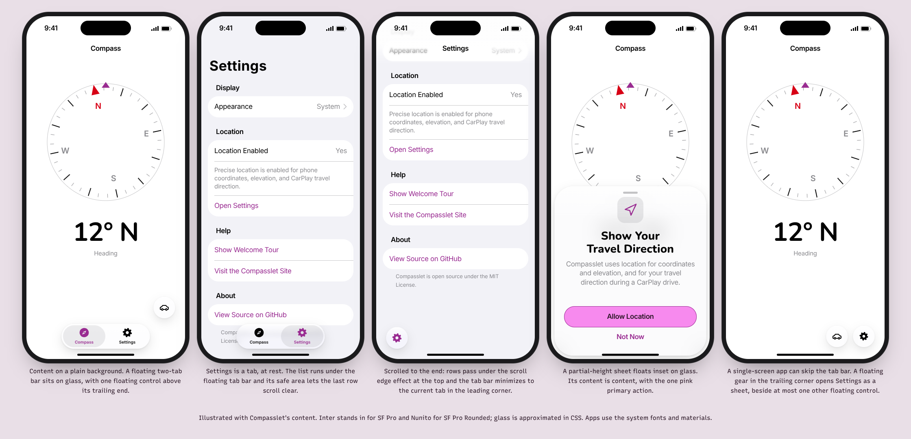
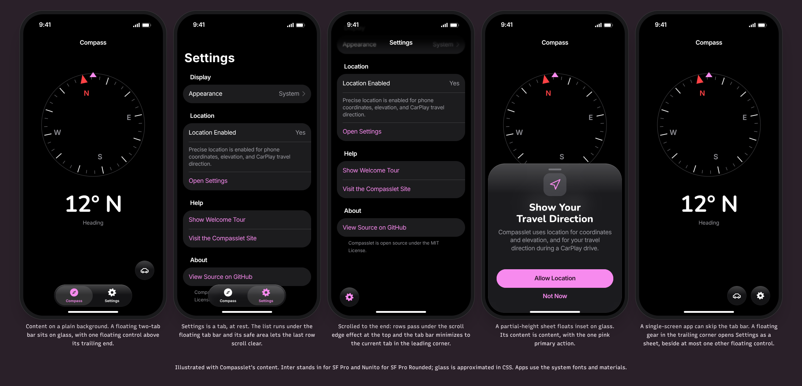
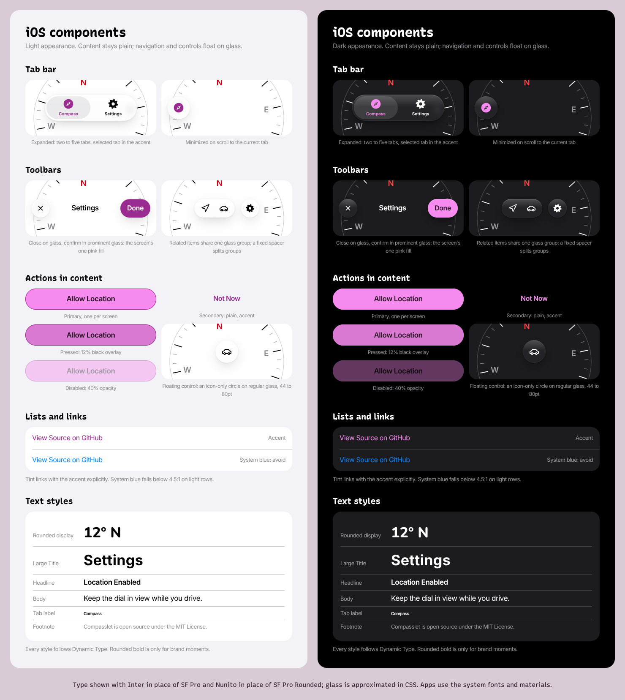
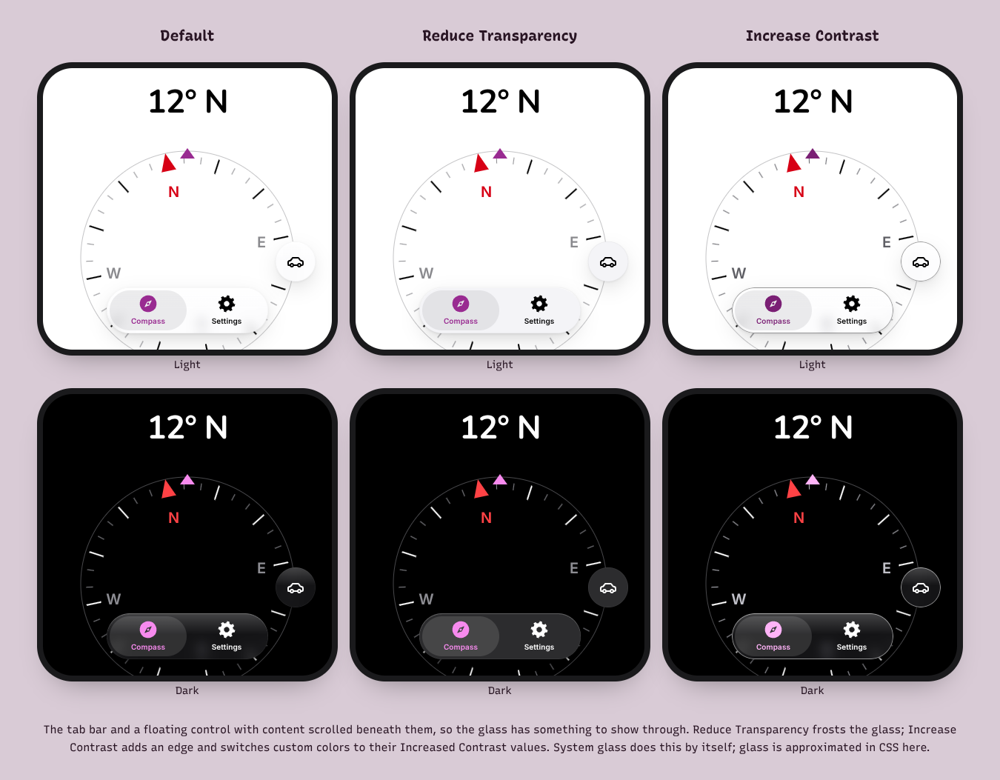

# iOS view guide

How the [foundation](foundation.md) maps onto Lunchbox Labs iPhone apps. Current consumer: Compasslet (`lunchbox-labs/compasslet`). Native first: an app should feel like it belongs on iPhone, with the brand in its accent, its display type and its one primary action. Web pixel values don't carry over.

Apps are built for Liquid Glass. Content sits on plain system backgrounds, and navigation and controls float above it on glass. Most of that comes free from system components; this guide says where the brand goes on top and what to check.

## Two layers

- **Content layer:** what the screen is about, such as a dial, a list, a form or a tray of compartments. It uses opaque system backgrounds and grouped rows, and stays flat as the foundation's depth rule says.
- **Glass layer:** the tab bar, navigation bar items, toolbars, sheets, menus, popovers and floating controls. It floats above content, and content scrolls beneath it.
- Never put Liquid Glass on content: no glass cards, rows, backgrounds, banners or decorative panels. If content needs separation, use a grouped background or, over media, a standard material such as `.thinMaterial`.
- Use system components first. `TabView`, `NavigationStack`, `.toolbar`, `.sheet`, `Menu` and the standard buttons adopt glass, the scroll edge effect and the accessibility fallbacks on their own. Don't add custom backgrounds to them (`.toolbarBackground`, `.presentationBackground` or a color behind a bar), because they cover the system's effects.
- Custom glass is for the one or two most important custom controls on a screen, such as a floating control. Apply it with `.glassEffect(_:in:)` or the `.glass` button style, and put nearby glass shapes in one `GlassEffectContainer` so they render and morph together. Never stack glass on glass.
- Use the regular glass variant. The clear variant is only for controls over photos, video, maps or a camera feed; add a 35% black dimming layer under it when the content behind can be bright.
- Leave the scroll edge effect on so text stays legible where content passes under glass. A custom bar that content scrolls under goes in `.safeAreaBar` to get the same effect.
- The resting state, with content scrolled to the top, has to be fully legible. Color that only passes under the glass while scrolling is fine.

## Navigation

- **Tab bar:** top-level sections go in the system tab bar, which floats at the bottom of the screen. Two to five tabs, each with a filled SF Symbol and a one-word label. Tabs switch sections; actions on the current screen go in a toolbar.
- **Minimizing:** where content is the point of the screen, such as a long list or feed, let the tab bar minimize with `.tabBarMinimizeBehavior(.onScrollDown)`. It shrinks to the current tab in the leading corner as people scroll and expands when they scroll back toward the top or tap it. Don't build a custom collapsing bar.
- **Bottom accessory:** something people glance at from every tab, like a live status, goes in `.tabViewBottomAccessory`. It moves inline beside the minimized tab bar, so read `tabViewBottomAccessoryPlacement` and show a shorter form there. Leave it out when nothing earns that place.
- **Search:** a search tab uses `Tab(role: .search)`, which the system places at the trailing end.
- **Settings:** in an app with a tab bar, Settings is a regular tab, usually the last one. Only a search tab keeps its own place at the trailing end when the bar minimizes, so don't give Settings the search role or float a custom button there to imitate one.
- **Single-screen apps:** an app with one main screen may skip the tab bar. Settings then opens as a sheet from a floating `gear` button on regular glass in the bottom trailing corner. Another floating control can sit beside it in the same `GlassEffectContainer`, two at most.
- **Floating controls with a tab bar:** on a screen with a tab bar, a floating control sits above the trailing end of the bar and any bottom accessory, never inline beside it, where it would read as a search tab.
- **Header:** never draw a custom header row of icons above content; the navigation bar and its toolbar items are the header.
- **Titles:** a large title on top-level screens and an inline title deeper in. A screen built around one drawing, like a dial, may use an inline title at the top level. Back stays at the top leading edge, and the swipe from the leading edge always goes back.
- **Toolbars:** group items that act on the same thing and separate groups with `ToolbarSpacer(.fixed)`. Within a group use icons or text, not both. Every icon has an accessibility label. Hide a whole item with `.hidden()` rather than leaving an empty one.

## Color

- Backgrounds, labels, separators and fills use the system's semantic colors (`systemBackground`, `systemGroupedBackground`, `secondarySystemGroupedBackground`, `label`, `secondaryLabel`, `separator`). The web's pink-tinted neutrals stay on the web. `secondaryLabel` is below 4.5:1 on light rows, so use it only for supporting text and check it with Increase Contrast on; essential text uses `label`.
- `AccentColor` in the asset catalog is the strong pink: `#992B91` in light, `#F78AEE` in dark. It tints links, toggles, selected states, the selected tab and the confirming toolbar button.
- Glass has no color of its own. Text and symbols on it use the system's vibrant label colors, which follow what passes beneath. Only the selected tab and a prominent button carry the accent.
- **One pink fill per screen.** Tint glass with pink only for the screen's one confirming toolbar button (`.buttonStyle(.glassProminent)`, "Done"), or fill the one primary action in content with brand pink. Never both on one screen, and never tint the tab bar, a toolbar group or several buttons.
- A filled accent button uses a white label in light and the pink label `#281423` in dark (`ConfirmActionLabel` in Compasslet); [organization colors](colors.md) has the ratios.
- The brand pink `#F78AEE` with the `#281423` label fills the one primary action in content, as a capsule with a 1pt accent border. Keep it as named colors in the asset catalog (`PrimaryActionFill`, `PrimaryActionLabel`).
- Darken a pressed pink button with a 12% overlay, as the foundation's press rule says.
- Functional colors stay functional: a compass's north marker stays red, and the system's destructive red stays red. Brand pink never stands in for a status.
- Every custom color has light, dark and Increased Contrast values, because glass adapts to all of them:

| Color | Light | Dark | Increased contrast light | Increased contrast dark |
| --- | --- | --- | --- | --- |
| `AccentColor` | `#992B91` | `#F78AEE` | `#7A1F74` | `#FFB3F7` |
| `PrimaryActionFill` | `#F78AEE` | `#F78AEE` | `#F78AEE` | `#F78AEE` |
| `PrimaryActionLabel` | `#281423` | `#281423` | `#000000` | `#000000` |
| `ConfirmActionLabel` | `#FFFFFF` | `#281423` | `#FFFFFF` | `#000000` |

Checked pairs for the increased contrast values: `#7A1F74` on white 9.23 and on `systemGroupedBackground` 8.27, white on `#7A1F74` 9.23, `#FFB3F7` on black 13.04 and on `secondarySystemGroupedBackground` 10.57, black on `#F78AEE` 9.82, black on `#FFB3F7` 13.04. The increased contrast accent border on the pink fill is 4.32 in light; in dark the fill itself carries the contrast against the background.

## Type

- Text styles only (`.largeTitle` through `.caption2`), so everything follows Dynamic Type. Fixed sizes only for drawings that scale with their container, like a dial.
- The display voice is SF Pro Rounded: apply `.fontDesign(.rounded)` with a bold weight to brand moments such as a large reading, an onboarding or permission title, or an empty state's headline. Navigation titles, tab labels, lists and body text stay SF Pro.
- SF Mono for code and identifiers; `.monospacedDigit()` for numbers that change in place.
- Title case for navigation titles, tab labels, section headers and control labels; sentence case for explanations, footers and alerts' messages. Compasslet's AGENTS.md has the full casing rule.

## Layout, spacing and shape

- Use the system's margins and list insets (16pt on most iPhones, 20pt on the largest), not web gutters.
- Spacing inside custom views uses the foundation's 4pt steps, wrapped in `@ScaledMetric` where it sits next to text so it grows with Dynamic Type.
- Settings and forms use `Form` or inset grouped lists, which already match the glass layer's corners.
- Corners are concentric with what holds them, down to the device's own corners. Use `ConcentricRectangle` for a custom shape inside a sheet, card or screen edge, with `.concentric(minimum:)` where it can sit far from a rounded corner, and capsules for buttons. A custom container sets `containerShape(_:)` so what's inside can follow it. A standalone card in content uses a 20pt continuous corner.
- Leave room at the bottom of scrolling content for the floating tab bar; the safe area does this when content isn't pinned to the edge.
- Respect safe areas and keep the main control within thumb reach near the bottom.
- Targets at least 44 by 44pt, including icon-only buttons and minimized bars.

## Components

| Component | Look |
| --- | --- |
| Tab bar | The system tab bar, two to five tabs, selected tab in the accent. Minimizes on scroll where content is the point. |
| Toolbar buttons | System glass items, grouped by what they act on, icons with accessibility labels. |
| Toolbar confirm | `.glassProminent` tinted with the accent, white or pink label as above ("Done"). Counts as the screen's pink fill. |
| Close | The system close button (`xmark`) on glass at the top leading edge of a sheet. |
| Primary action | Pink capsule in content, pink-label text, semibold body, at least 50pt tall, full width in sheets. One per screen. |
| Secondary action | Plain button in the accent, below the primary ("Not Now"). |
| Floating control | An icon-only circle on regular glass (`.glassEffect(.regular.interactive(), in: .circle)` or the `.glass` button style with `.buttonBorderShape(.circle)`), 44 to 80pt, with a label for VoiceOver and the large content viewer. At most one or two per screen; a single-screen app's Settings gear is one of them. |
| Links in lists | Tinted with the accent explicitly; system blue falls below 4.5:1 on light rows. |
| Sheets | System sheets with detents. Partial heights float inset on glass and full height turns opaque, both on their own. A permission or explainer sheet has an SF Symbol in a soft fill, a rounded bold title, one or two sentences, then the primary action. Content inside a sheet is content: no extra glass in it. |
| Menus and action sheets | System menus, which morph out of their button. A confirmation dialog is anchored to the control that opened it. |

## Motion

- System transitions for navigation, sheets, menus and alerts. Open a sheet from its button with `.navigationTransition(.zoom(sourceID:in:))` and `.matchedTransitionSource` where it helps people see where it came from.
- The system's own glass motion, such as flexing under a finger, morphing and the tab bar minimizing, is allowed even though it has spring. Don't imitate it in custom views.
- Custom animation uses `.smooth` springs or `.spring(duration: 0.28, bounce: 0)`, or ease-out curves at the foundation's durations. No bounce. Morph custom glass with `.glassEffectID(_:in:)` inside a `GlassEffectContainer`.
- With Reduce Motion on, swap movement for a short fade or nothing.
- Haptics only to confirm something meaningful, never on every tap.

## Accessibility and fallbacks

Glass changes with accessibility settings, the Liquid Glass look and what's behind it, so it has no fixed contrast value. Check it in the real app.

- **Reduce Transparency:** system glass turns frosted and nearly opaque by itself. Any hand-made translucency (opacity or blur that isn't `.glassEffect` or a system material) reads `accessibilityReduceTransparency` and swaps to an opaque `secondarySystemBackground`.
- **Increase Contrast:** system glass adds a stronger edge and darker or lighter labels. Custom colors switch to their Increased Contrast values from the table above.
- **Reduce Motion:** system glass calms its own motion; custom morphs become a fade.
- **The Liquid Glass look setting:** people can make glass clearer or more tinted in Settings. Check custom glass at both ends.
- **Contrast floors on glass:** text and the selected tab at least 4.5:1, icons and control edges at least 3:1, measured from screenshots at rest over the lightest and darkest content that can sit behind, with the clearest look. If a floor fails, move color out from under the bar or use a system component, never thicken the glass by hand.

## Icons

- SF Symbols, sized with the text style beside them. Use the filled variant for selected states and tabs.
- The app icon is built in layers in Icon Composer from solid, filled shapes, with default, dark, clear and tinted variants; the system adds the glass effects. The brand pink can appear in it, but legibility at small sizes comes first.

## Checks for an iOS change

- Light and dark, with Increase Contrast, Reduce Transparency and Differentiate Without Color on.
- The clearest and most tinted Liquid Glass looks, and Reduce Motion, on any screen with custom glass.
- Each scrolling screen at rest and scrolled, with the tab bar expanded and minimized.
- The largest accessibility text size on the main screens, including tab labels.
- A small iPhone (375pt wide) and a large one (440pt wide).
- VoiceOver labels and order for every custom control and toolbar icon.
- Screenshots come from the app's own Screenshots workflow, not from temporary branches.
