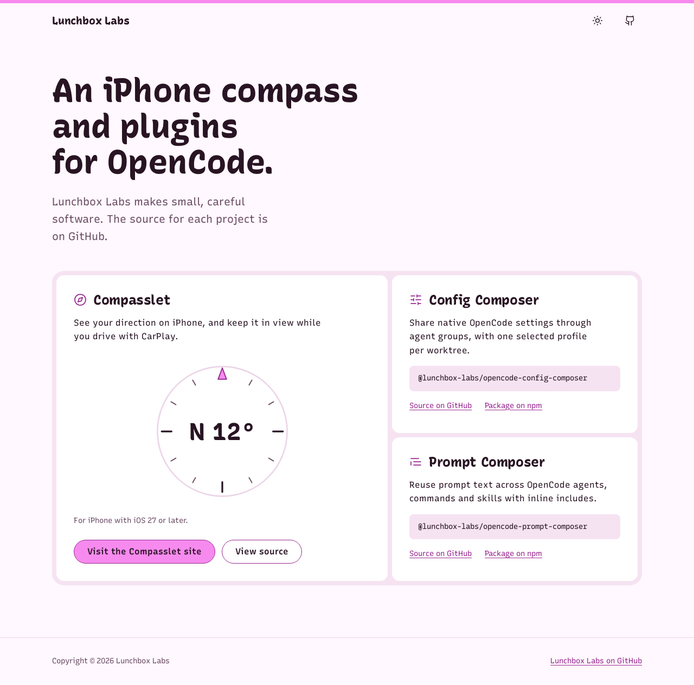
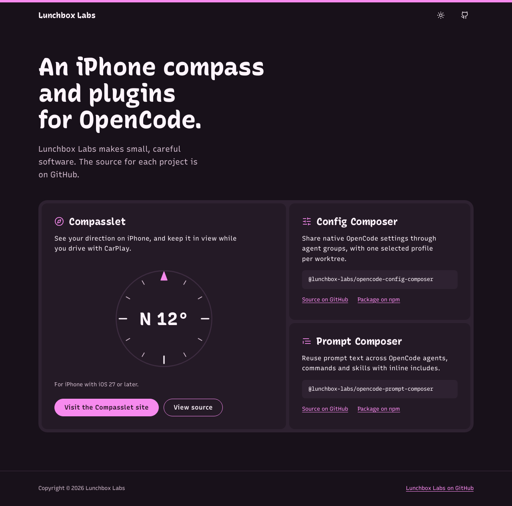
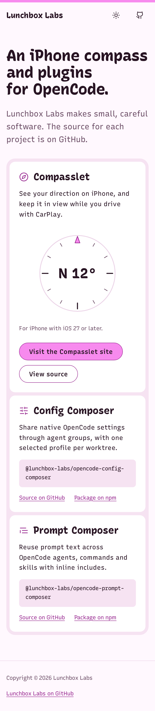
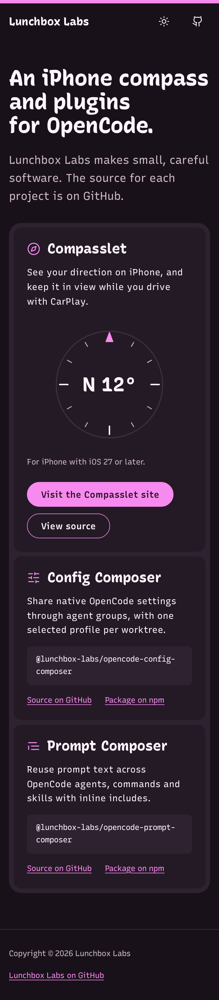

# Web view guide

How the [foundation](foundation.md) maps onto Lunchbox Labs websites. Current consumers: the org site (`lunchbox-labs/lunchbox-labs.dev`) and Compasslet's site (`website/` in `lunchbox-labs/compasslet`), both built with Zensical. The reference token file is [tokens.css](tokens.css).

| Mobile, light | Mobile, dark |
| --- | --- |
|  |  |

## Tokens

- Expose every foundation token as a CSS custom property with the `--ll-` prefix, set once on `:root` and per appearance. [tokens.css](tokens.css) follows the system appearance with `light-dark()` (Safari 17.5, Chrome 123 and Firefox 120 or later) and accepts a `data-theme` override; a framework with its own theme selector uses that instead (Zensical uses `[data-md-color-scheme="default"]` and `"slate"`).
- Map Zensical's `--md-*` variables onto `--ll-*` tokens rather than raw hex values.
- Pages use token names, never raw values.

## Type

- Self-host Recursive as one variable `woff2`, subset to Latin, with `font-display: swap`. Zensical's `font = false` stays, so the theme doesn't load Google Fonts.
- Select voices with `font-variation-settings`: `"CASL" 1` for headings, `"CASL" 0` for body, `"MONO" 1` for code.
- Fallbacks: `system-ui` for text and `ui-monospace` for code, so the page reads well before the font arrives.
- Body is 16px with a 1.6 line height and a 65 character measure. The hero heading is 61px on wide screens and 39px below 760px.

## Layout

- Content width 72rem, side gutter between 16px and 32px depending on the viewport, sections 64px to 96px apart.
- Left-align headings and text. Center only short, single-line things like an empty state.
- The hero is a heading and one lead paragraph. Keep it quiet: the tray below is the memorable part.
- On a site with one main thing (Compasslet's site), the tray can hold a single compartment, or be skipped.

## The tray

The signature component. A page uses at most one.

- A `--ll-tray` container with 22px corners and 8px padding and gap, holding `--ll-surface` compartments with 14px corners and 24px to 32px padding.
- Compartments may differ in size to show weight: the featured project spans two rows, the rest share one each. Don't make every compartment the same.
- No shadow on the tray or compartments. Hover changes only a link or button inside, not the whole compartment.
- Below 760px the tray stacks into one column; the gap stays 8px.
- In Zensical, style the existing `grid cards` markup as the tray rather than writing HTML.

## Header and footer

- A 6px pink band along the top edge of the header. It's the one place pink spans the full width.
- The site name in the display voice, then icon buttons (appearance toggle, GitHub) on the right, each 44px square with an accessible name.
- A plain footer: hairline on top, copyright and one or two links in muted text. No link farms or newsletter boxes.

## Controls

| Control | Look | States |
| --- | --- | --- |
| Primary button | Pink pill, pink-label text, 1.5px strong-pink border in light (pink in dark), 44px tall | Hover darkens 10%, press 18%, focus outline, disabled becomes an outlined grey pill |
| Secondary button | Transparent pill, text color, 1.5px strong-pink border | Hover fills with tint |
| Quiet button | Strong-pink text, no border | Hover fills with tray |
| Link | Strong pink, underlined at 1px, offset 0.18em | Hover thickens the underline to 2px |
| Field | Surface fill, 1.5px strong-pink border, 8px corners, 44px tall, label above, hint below in muted text | Focus outline outside the border; error adds the error color to the border and an icon with words below |
| Code block | Tray fill, 8px corners, Recursive Mono at 14px, long names wrap | Copy button, if any, is a quiet icon button with a name |

- One primary button per view. Everything else is secondary, quiet or a link.
- Darken pink on hover and press with an overlay, as the foundation's press rule says.
- Don't append arrows to button or link text.
- Separate inline links with space, not middle dots.

## Focus and motion

- Focus: `outline: 3px solid var(--ll-focus); outline-offset: 3px`, never removed. Header icon buttons use an inset offset so the outline isn't clipped.
- Transitions use the fast token for color and the base token for anything that moves. No scroll-triggered entrance on every section.
- Under `prefers-reduced-motion: reduce`, transitions that move or scale switch to opacity or to none; the duration tokens alone don't remove movement.
- Honor `prefers-reduced-motion`, `prefers-contrast: more` (draw hairlines in strong pink and muted text in the text color) and `forced-colors` (let system colors take over and keep outlines).

## Checks for a web change

- Contrast for every new pair, including hover, pressed, selected and disabled, in both appearances.
- Screenshots at desktop (1280px) and mobile (390px) widths in light and dark.
- 320px wide and 200% zoom without horizontal scrolling.
- Keyboard: every control reachable, focus visible, order matches the page.
